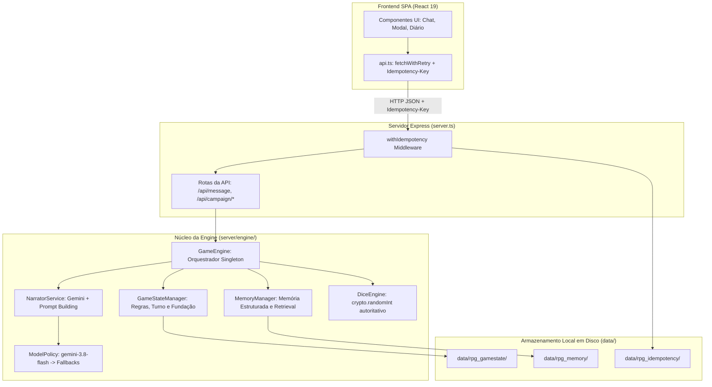
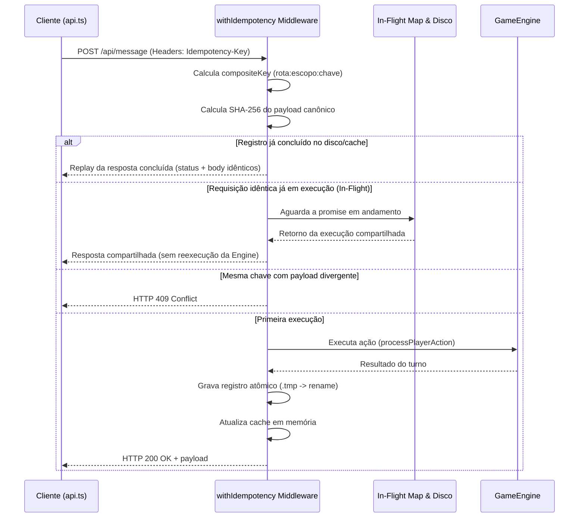
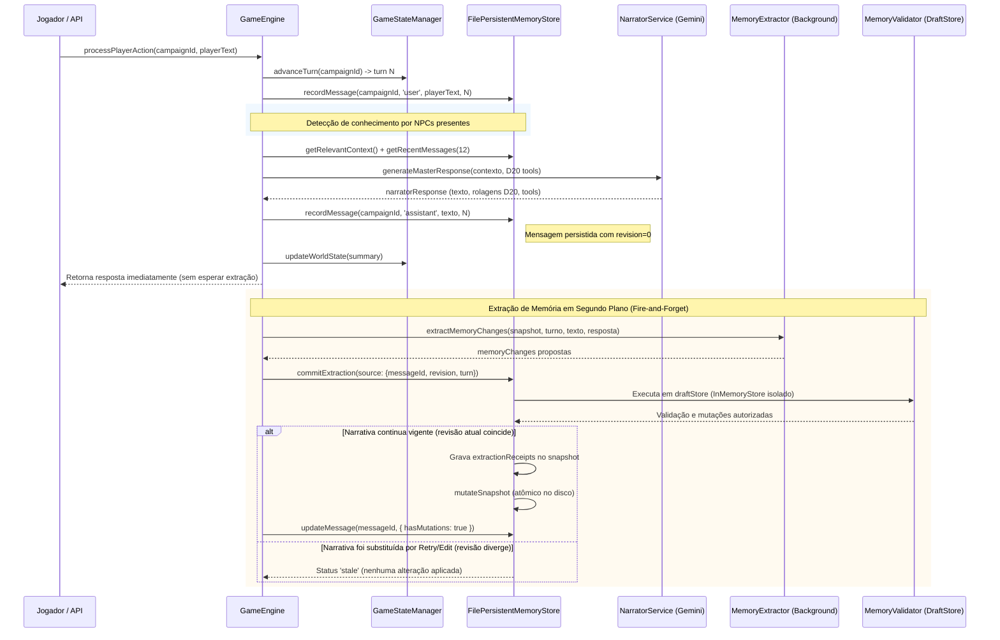

# RPG-Master — Mapa da Arquitetura do Sistema

> **Documento Canônico de Arquitetura Técnica**  
> Data de referência: 09/10/2026.  
> Este documento descreve a topologia, os fluxos de execução, os pontos de persistência, os invariantes de domínio e os limites de atomicidade do RPG-Master com base estrita no código-fonte em produção.

---

## 1. Visão Geral e Separação de Responsabilidades

O RPG-Master é projetado sob o princípio da **separação rígida de autoridade**:
- **Modelos de IA (Google Gemini)**: Atuam como Narradores e Mestres de Jogo (interpretação dramática, diálogos de NPCs e descrição sensorial do mundo). A IA **não tem autoridade direta de escrita** sobre o estado persistente do jogo nem sobre a resolução de mecânicas determinísticas.
- **Game Engine (Backend Node.js)**: Autoridade soberana de estado, avanço de turnos, resolução mecânica (RNG/D20), validação lógica e orquestração de persistência.
- **Memory Layer (Camada de Memória Estruturada)**: Armazenamento e retrieval de dados epistemológicos, relacionamentos sociais, inventário, eventos e objetivos de quests.
- **Frontend (React 19 / Vite)**: Cliente SPA responsável pela interface de chat, diário, criação de campanha e diagnóstico técnico.

---

## 2. Diferenciação de Fluxos: Produção vs Alternativos/Testes

### Fluxo Canônico de Produção (`GameEngine`)
O arquivo [`server.ts`](../server.ts) instancia e consome diretamente a classe [`GameEngine`](../server/engine/gameEngine.ts). Todas as rotas de API da aplicação em produção passam exclusivamente pelo `GameEngine`:
- `POST /api/message` -> `gameEngine.processPlayerAction`
- `POST /api/message/retry` -> `gameEngine.retryLastPlayerAction`
- `POST /api/message/edit` -> `gameEngine.editLastPlayerAction`
- `POST /api/campaign/new` -> `gameEngine.startNewCampaign`
- `GET /api/campaign/:id` -> `gameEngine.getCampaignDetails`
- `DELETE /api/campaign/:id` -> `gameEngine.deleteCampaign`

### Fluxo Alternativo/Legado (`TurnProcessor`)
O componente [`TurnProcessor`](../server/engine/turn/turnProcessor.ts) implementa um orquestrador alternativo de turnos com fila interna e extração síncrona/retentativa.
- **Evidência no código**: `TurnProcessor` **não é importado nem utilizado por `server.ts`** nem pela rota oficial de envio de mensagens.
- **Uso atual restrito**: Utilizado apenas em [`server/engine/narrator/memoryTools.ts`](../server/engine/narrator/memoryTools.ts) e por testes isolados legados ([`fullTurnLifecycle.test.ts`](../server/engine/turn/fullTurnLifecycle.test.ts) e [`pending_extraction_retry.test.ts`](../server/engine/memory/extractor/pending_extraction_retry.test.ts)).
- **Diretriz arquitetural**: `TurnProcessor` é considerado um fluxo secundário a ser descontinuado ou unificado no `GameEngine` (Decisão Arquitetural **A4**).

---

## 3. Camada de API e Serviço de Idempotência

O serviço de idempotência ([`server/engine/idempotency/idempotencyService.ts`](../server/engine/idempotency/idempotencyService.ts)) protege todas as rotas mutáveis contra duplicação de efeitos em retries de rede ou falhas transitórias.

### Invariantes de Idempotência
1. **Chave Composta**: `${rota}:${escopo}:${idempotencyKey}`.
2. **Canonicalização de Payload**: Chaves de objetos JSON são ordenadas recursivamente em ordem alfabética (`canonicalizeJson`) antes de gerar o hash SHA-256.
3. **Persistência Atômica de Registros**: O registro de conclusão é serializado em arquivo temporário (`.tmp`) e comitado via `fs.renameSync` em `data/rpg_idempotency/` antes de atualizar o cache em memória. Erros de I/O lançam `IdempotencyPersistenceError`.

---

## 4. Ciclo de Vida do Turno e Extração Assíncrona

O fluxo de processamento de um turno do jogador (`processPlayerAction`) no `GameEngine` opera nas seguintes fases:

### Garantias de Identidade e Anti-Stale (P0.2)
1. **Identidade de Revisão**: Cada mensagem do narrador possui um campo `revision: number`. Quando a narrativa é substituída por um Retry ou Edit, a nova mensagem recebe `revision = (revisão_anterior + 1)`.
2. **Descarte Atômico (`stale`)**: O `commitExtraction` adquire a fila de escrita da campanha (`executeWithCampaignWriteLock`). Se a mensagem no store tiver revisão divergente da `ExtractionSource` original, o commit é cancelado sem tocar no snapshot persistente.
3. **Deduplicação por Recibo (`extractionReceipts`)**: O snapshot armazena recibos persistidos `snapshot.extractionReceipts[messageId] = { revision, turn, hasMutations }`. Extrações repetidas da mesma revisão retornam status `'duplicate'`.
4. **Isolamento via Draft**: O `MemoryValidator` opera estritamente sobre uma cópia descartável em memória (`InMemoryStore`). Qualquer exceção ou rejeição aborta a operação sem tocar no filesystem.

---

## 5. Arquitetura de Retry e Edit da Narrativa

As operações de repetição e edição da ação do jogador implementam garantias não destrutivas:

### Retry (`retryLastPlayerAction`)
- **Preservação de Narrativa em Falha**: A resposta anterior do Mestre **não é apagada** antes da geração da nova resposta. Se o Gemini falhar por timeout, 429 ou erro de API, a narrativa original continua intacta no disco e no cache.
- **Detecção de Conflitos**: Valida se novas mensagens foram inseridas no histórico enquanto a geração ocorria.
- **Substituição Atômica**: Utiliza `FilePersistentMemoryStore.replaceMessage`, substituindo a mensagem no histórico mantendo o mesmo `id` e incrementando a `revision`.
- **Invariante de Consolidação**: Bloqueia retry caso a mensagem já possua `hasMutations: true` ou recibo consolidado no snapshot.

### Edit (`editLastPlayerAction`)
- **Isolamento Transitório**: A ação editada do jogador e a resposta a ser recalculada são manipuladas em uma estrutura transitória em memória durante a chamada do Narrador.
- **Substituição do Par Atômico**: Utiliza `FilePersistentMemoryStore.replaceTurnMessages`. O par `user + assistant` é substituído em uma única operação física de I/O sob o lock da campanha.
- **Validação de Concorrência (`ExpectedTurnState`)**: Verifica se o conteúdo do jogador, turno e resposta do assistente não sofreram mutação concorrente durante a chamada de rede.
- **Invariante Mecânico**: Edições são rejeitadas caso o turno contenha rolagens de dados já resolvidas (`diceRolls`) ou alterações de estado consolidadas (`hasMutations`).

---

## 6. Persistência, Armazenamento e Limites de Atomicidade

### Estrutura de Diretórios em Disco (`./data/`)
- `data/rpg_gamestate/`: Arquivos `gamestate_{campaignId}.json` gerenciados pelo `GameStateManager`.
- `data/rpg_memory/`:
  - `memory_{campaignId}.json`: Snapshots de entidades estruturadas (NPCs, eventos, inventário, relacionamentos, quests, registros semânticos).
  - `chat_{campaignId}.json`: Histórico de mensagens do chat com metadados e revisões.
- `data/rpg_idempotency/`: Registros de requisições concluídas indexados por hash da chave composta.

### Padrão Atômico de Escrita (Safe Write Pattern)
Tanto o `GameStateManager` quanto o `FilePersistentMemoryStore` e o `IdempotencyManager` implementam o padrão seguro de gravação:
1. **Clone Destacado**: Mutações são calculadas sobre cópias profundas destacadas (via `cloneSnapshot` / `cloneGameState`), impedindo aliasing de referências com o cache em memória.
2. **Arquivo Temporário**: O payload serializado é gravado em um arquivo temporário no mesmo diretório (`.json.tmp.{timestamp}_{random}`).
3. **Rename Atômico**: O arquivo temporário substitui o arquivo de destino usando `fs.rename` (ou `fs.renameSync`). No Linux e no Windows no mesmo sistema de arquivos, a substituição via rename é tratada atomicamente pelo sistema operacional.
4. **Atualização do Cache por Último**: O cache em memória só é atualizado após a confirmação do `rename`. Em caso de erro de I/O, o cache mantém a última versão confirmada e a exceção é propagada ao chamador.

### Limites e Restrições de Atomicidade
> [!WARNING]
> **Limites Atuais de Atomicidade**:
> 1. **Isolamento por Processo Único**: As filas de escrita (`executeWithCampaignWriteLock`) e caches são locais ao processo Node.js. O sistema não suporta múltiplos processos Node.js operando concorrentemente sobre a mesma pasta `data/` sem um lock distribuído externo.
> 2. **Ausência de Transação Multi-Domínio (P0.3)**: Não existe um coordenador transacional unificado entre `GameStateManager`, `FilePersistentMemoryStore` e `IdempotencyManager`. Uma falha súbita de energia entre a escrita de um arquivo e outro pode gerar inconsistência entre domínios.

---

## 7. Invariantes de Domínio e Contratos Mecânicos

### Epistemologia e Conhecimento
A memória do jogo classifica informações estruturadas de acordo com níveis epistemológicos estritos:
- `WORLD_TRUTH`: Fatos objetivos do universo definidos na fundação da campanha.
- `DIRECT_OBSERVATION`: Acontecimentos presenciados diretamente pelo personagem.
- `REPORTED_INFORMATION`: Fatos relatados por terceiros.
- `RUMOR` / `SUSPICION`: Boatos e suspeitas sem confirmação formal.
- `BELIEF` / `FALSE_BELIEF`: Crenças e convicções individuais (podendo ser factualmente falsas sem violar a consistência do mundo).
- `DISPUTED` / `UNKNOWN`: Informações em disputa ou desconhecidas.

**Invariante Epistemológico**: Um rumor ou crença falsa de um NPC pode alterar relacionamentos sociais e comportamento sem que seu conteúdo seja promovido a `WORLD_TRUTH` no snapshot do mundo.

### Resolução de Rolagens D20
A mecânica de RPG adota resolução determinística server-side ([`server/engine/dice/diceEngine.ts`](../server/engine/dice/diceEngine.ts)):
- **Fonte RNG**: `crypto.randomInt(1, 21)` para geração criptográfica de números inteiros entre 1 e 20.
- **Classificação de Dificuldade**:
  - `TRIVIAL`: Sucesso automático sem necessidade de rolagem.
  - `IMPOSSIBLE`: Falha automática justificada pelas regras do universo.
  - `UNCERTAIN`: Rolagem de D20 obrigatória com modificadores de personagem.
- **Outcome**: `CRITICAL_SUCCESS`, `SUCCESS`, `SUCCESS_WITH_COST`, `FAILURE`, `CRITICAL_FAILURE`.
- **Invariante Mecânico**: O resultado numérico retornado pelo motor de dados é autoritativo. O Narrador (IA) recebe o resultado como um fato consumado e deve narrar as consequências de acordo com o outcome mecânico.

---

## 8. Riscos Arquiteturais Mapeados

1. **Risco P0.4 (Corrupção tratada como ausência)**: `internalGetSnapshot` captura erros genéricos de leitura e retorna `null`, permitindo que arquivos de save corrompidos sejam acidentalmente sobrescritos como novos snapshots vazios.
2. **Risco P0.5 (Race Condition em Deleção)**: A exclusão de campanha apaga arquivos no disco, mas leituras antigas em trânsito podem repopular caches caso não sejam invalidadas.
3. **Risco P3.4 (Crescimento de Snapshot e Latência de Embeddings)**: O cálculo de embeddings e indexação semântica é executado de forma síncrona dentro da seção crítica da campanha (`executeWithCampaignWriteLock`), o que pode elevar a latência de turnos em campanhas longas com histórico volumoso.
